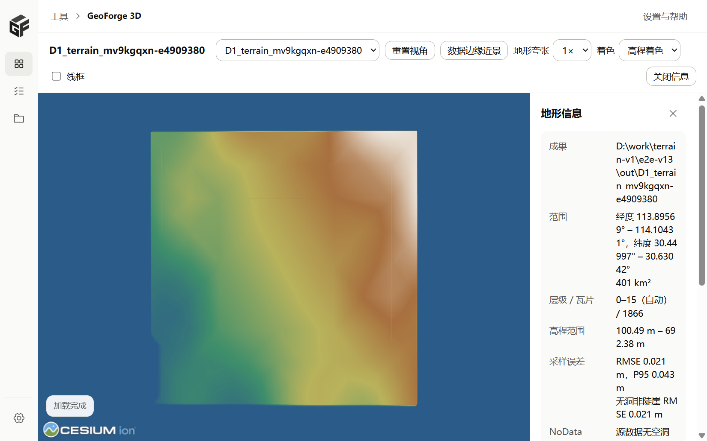
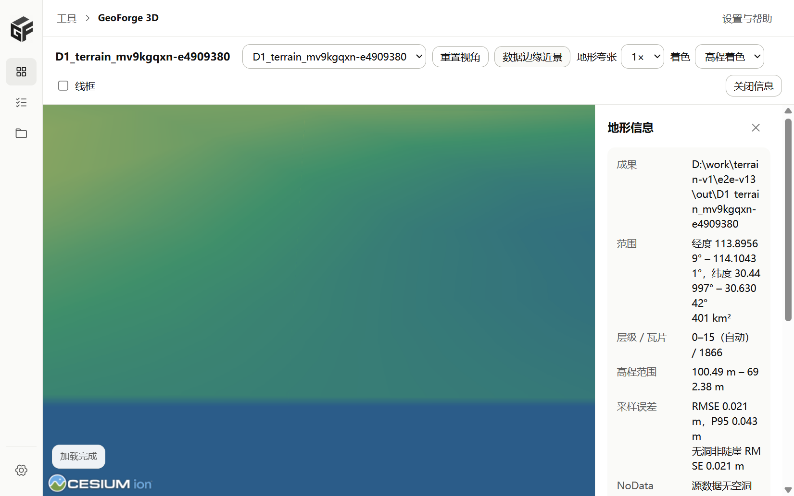
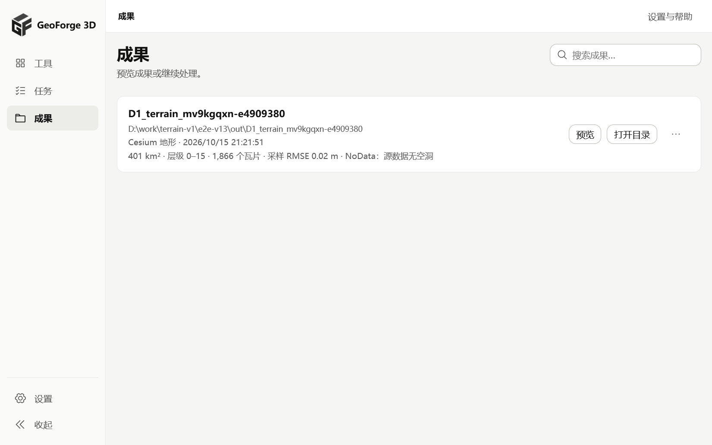

# 地形 V1.3：成果登记与离线预览

## 范围

V1.3 让地形切片任务的输出成为可以预览的成果：

- T13.1：登记 `kind=terrain` 成果，资源服务默认入口为 `layer.json`（PR #17）。
- T13.2 / T13.3：桌面端地形预览页、成果列表和任务页的预览入口（本文对应 PR）。

3D Tiles 预览页、裁剪/压平工具和 Range 请求不变。

## 成果登记（T13.1）

- 任务成功后，输出目录有 `tileset.json` 时登记为 `3dtiles`，只有 `layer.json` 时登记为 `terrain`。旧记录中 kind 为 `3dtiles` 但只有 `layer.json` 的，读取时按 `terrain` 显示。
- 成果记录新增 `entryFile`、`previewable`、`status`（`ok` / `missing` / `incomplete`）和 `terrain` 摘要。摘要只读 `geoforge-terrain.json`，不重新扫描 DEM。
- 不会因为没有 `tileset.json` 把地形成果判为无效。
- `.terrain` 瓦片继续按 gzip 原样返回，带 `Content-Encoding: gzip`，不支持 Range（V1.1 起如此）。

## 预览页（T13.2）

路由：`/preview/terrain?artifact=<id>`。页面内嵌 `public/terrain-preview.html`，用 `CesiumTerrainProvider.fromUrl` 加载本地资源服务的 `layer.json`。

- 离线：不使用 Cesium ion，不加载在线影像，`baseLayer: false`。颜色只表示高程（高程着色或等高线）。左下角的 Cesium 标志是本地静态资源，不发请求。
- 自动定位：按报告里的 `dataBounds` 外扩 15% 显示全幅。
- 数据边缘近景：相机放在西边界外侧，向东俯视，看边界和瓦片接缝。
- 地形夸张 1× / 2× / 3× / 5×，只改变显示，鼠标处高程按原始米数显示。
- 线框（Cesium 调试线框）、重置视角、鼠标处经纬度和高程（数据范围外会注明）。
- 错误提示：加载前先取第一张瓦片，如果浏览器拿到的仍是 gzip 字节（资源服务没带 `Content-Encoding`），直接提示原因；`layer.json` 缺失、目录被移动等错误也显示在页面顶部。
- 任务没有成功的输出不提供预览按钮，也不登记为可预览成果。

## 成果列表与任务页（T13.3）

- 成果列表显示“Cesium 地形”、面积、层级、瓦片数、采样 RMSE、NoData 策略和路径，操作为预览和打开目录；地形成果不显示“继续处理”。
- 目录被移动或删除时显示“文件不存在”和处理建议（恢复原位置后刷新，或重新运行任务）。
- 成果记录在应用重启后保留（沿用已有成果库）。
- 任务页成功的地形任务提供“预览地形”：调用 `ensure_terrain_artifact`，没有登记过就先登记，再打开预览页。

## 测试

- `npm test`：`terrain-view.mjs` 的范围解析、全幅/边缘相机、高程换算、gzip 识别、首瓦片地址；`terrainArtifact.ts` 的摘要文案和路径显示。
- `npm run test:ui`（本机）：任务页“预览地形”调用 `ensure_terrain_artifact`；预览页拿到无 `Content-Encoding` 的 gzip 瓦片时显示可读错误。
- 桌面端 Rust 测试：地形成果登记、默认入口、kind 判断。
- 真实窗口（`scripts/terrain-desktop-e2e.py`，D1）：任务成功 → 预览地形 → 全幅加载完成 → 边缘近景加载完成 → 成果列表显示 Cesium 地形。脚本检查预览期间所有请求都指向本机，结果 `externalRequests: []`。

## 截图

全幅：

数据边缘近景：

成果列表：

## 风险

- 数据范围外是 0 m 的椭球面，D1 这类高程 100–700 m 的数据在边缘会出现“台阶”，这是显示效果，不是成果问题。是否要在范围外隐藏球面，留给产品决定。
- 预览不做垂直基准转换，报告里没有转换时高程按源数据显示。
- 真实窗口截图来自 WebView2 的 WebDriver 截图，没有拔网线测试；离线依据是脚本对请求地址的检查。
