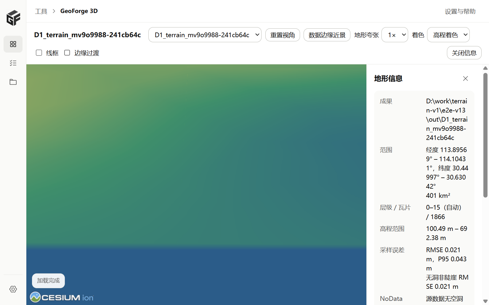

# 地形 V1.3：成果登记与离线预览

## 范围

V1.3 让地形切片任务的输出成为可以预览的成果：

- T13.1：登记 `kind=terrain` 成果，资源服务默认入口为 `layer.json`（PR #17）。
- T13.2 / T13.3：桌面端地形预览页、成果列表和任务页的预览入口（本文对应 PR）。

3D Tiles 预览页、裁剪/压平工具和 Range 请求不变。

## 成果登记（T13.1）

- 任务成功后，输出目录有 `tileset.json` 时登记为 `3dtiles`，只有 `layer.json` 时登记为 `terrain`。旧记录中 kind 为 `3dtiles` 但只有 `layer.json` 的，读取时按 `terrain` 显示。
- 成果记录新增 `entryFile`、`previewable`、`status`（`ok` / `missing` / `incomplete`）和 `terrain` 摘要。摘要只读 `geoforge-terrain.json`，不重新扫描 DEM。
- 不会因为没有 `tileset.json` 把地形成果判为无效。
- `.terrain` 瓦片继续按 gzip 原样返回，带 `Content-Encoding: gzip`，不支持 Range（V1.1 起如此）。

## 预览页（T13.2）

路由：`/preview/terrain?artifact=<id>`。页面内嵌 `public/terrain-preview.html`，用 `CesiumTerrainProvider.fromUrl` 加载本地资源服务的 `layer.json`。

- 离线：不使用 Cesium ion，不加载在线影像，`baseLayer: false`。颜色只表示高程（高程着色或等高线）。左下角的 Cesium 标志是本地静态资源，不发请求。
- 自动定位：按报告里的 `dataBounds` 外扩 15% 显示全幅。
- 数据边缘近景：相机放在西边界外侧，向东俯视，看边界和瓦片接缝。
- 地形夸张 1× / 2× / 3× / 5×，只改变显示，鼠标处高程按原始米数显示。
- 线框（Cesium 调试线框）、重置视角、鼠标处经纬度和高程（数据范围外会注明）。
- 错误提示：加载前先取第一张瓦片，如果浏览器拿到的仍是 gzip 字节（资源服务没带 `Content-Encoding`），直接提示原因；`layer.json` 缺失、目录被移动等错误也显示在页面顶部。
- 任务没有成功的输出不提供预览按钮，也不登记为可预览成果。

## 成果列表与任务页（T13.3）

- 成果列表显示“Cesium 地形”、面积、层级、瓦片数、采样 RMSE、NoData 策略和路径，操作为预览和打开目录；地形成果不显示“继续处理”。
- 目录被移动或删除时显示“文件不存在”和处理建议（恢复原位置后刷新，或重新运行任务）。
- 成果记录在应用重启后保留（沿用已有成果库）。
- 任务页成功的地形任务提供“预览地形”：调用 `ensure_terrain_artifact`，没有登记过就先登记，再打开预览页。

## 测试

- `npm test`：`terrain-view.mjs` 的范围解析、全幅/边缘相机、高程换算、gzip 识别、首瓦片地址；`terrainArtifact.ts` 的摘要文案和路径显示。
- `npm run test:ui`（本机）：任务页“预览地形”调用 `ensure_terrain_artifact`；预览页拿到无 `Content-Encoding` 的 gzip 瓦片时显示可读错误。
- 桌面端 Rust 测试：地形成果登记、默认入口、kind 判断。
- 真实窗口（`scripts/terrain-desktop-e2e.py`，D1）：任务成功 → 预览地形 → 全幅加载完成 → 边缘近景加载完成 → 成果列表显示 Cesium 地形。脚本检查预览期间所有请求都指向本机，结果 `externalRequests: []`。

## 截图

全幅：

数据边缘近景：

成果列表：

## 边缘过渡（V1.3 补充）

用户决定：保留数据边缘的台阶，不隐藏范围外的球面，只把过渡做得平缓一点。

### 做法：只在预览里画，不改瓦片

预览页在数据矩形外画一圈单独的坡面：
- 内沿取地形在边缘处的实际高程（`sampleTerrainMostDetailed`，每边 96 个点）。
- 向外按余弦曲线渐变到 0 m。宽度取数据短边的 5%，限制在 200 m 到 2 km（D1 约 1000 m）。
- 颜色沿用高程色带，但略偏灰，能看出是合成的。

工具栏的“边缘过渡”可以随时关掉，默认打开。信息栏和鼠标读数都会注明：范围外的 0 m 平面和这圈坡面只用于显示，不是成果数据。地形夸张时，坡面跟着一起缩放。

这样做的结果：
- 成果瓦片、`layer.json`、`geoforge-terrain.json` 都和改动前逐字节相同，处理器和地形运行时一行没改。
- 数据范围内的高程自然也没有任何变化。
- 粗层级边缘下塌的数量和改动前完全一样，没有变差。

### 为什么不在切片时加边带

我先试了处理器方案：在 CTB 输入外围加一圈余弦渐变边带（新的 `gf-dem-tool apron` 命令），用 7 个基准样例测了开和关两种情况。代码留在 `exp/terrain-edge-apron` 分支，没有开 PR，测量数据在 `docs/terrain/v1/measurements/v13-apron/`。

好处：
- 粗层级边缘下塌几乎消失。下塌顶点合计：D0 451→3，D1 213→1，D1 direct 2924→1，D3 76→0，M 128→4。
- 加边后，数据范围内的 DEM 像元逐个比对，不一致数为 0。

问题：这种方案满足不了“数据范围内高程零变化”这条硬规则。
- CTB 在生成一张瓦片时，会参考相邻瓦片的网格来防裂缝（`MeshTiler::prepareSettingsOfTile`）。边带改变了跨边缘那一圈瓦片，紧挨着它们的内侧一圈瓦片就会选到不同的 DEM 采样点。
  - D1 第 15 层：1184 张内部瓦片里有 113 张变了，表面最大差 1.4 m。
  - 共同顶点的高程完全相同，变的只是选点。
- 相邻瓦片接缝变大：M 从 0.027 m 增加到 0.46 m，D4 从 0.027 m 增加到 1.46 m，位置都在数据西边缘内侧几百米。
- 每个样例的瓦片多 4%–21%。

所以这次采用预览方案。处理器边带对 V1.4 的下塌问题有参考价值，但要先解决 CTB 的邻接耦合（例如给 CTB 打补丁），再决定要不要用。

### 截图（同一相机）

关闭边缘过渡（改动前）：

打开边缘过渡：

## 复制路径与重启保留

- 成果列表里的地形成果行新增“复制路径”按钮（原来只在“更多”菜单里）。复制时去掉 Windows 的 `\\?\` 前缀。
- 新增测试 `terrain_artifact_survives_an_app_restart`：用磁盘上的 SQLite 登记地形成果，再按应用启动的流程重新打开数据库并重建索引。之后检查：成果仍在列表里，类型是 terrain，入口是 `layer.json`，可以预览，报告摘要还在，资源服务能直接找到它。

## 风险

- 数据范围外仍是 0 m 的椭球面（用户决定保留台阶），边缘过渡只是预览里的视觉过渡。在粗层级远看时，CTB 瓦片边缘仍会向 0 m 下塌，过渡坡面的内沿可能和下塌的边缘之间有一条缝。
- 边缘过渡在加载时要多取一批最深层的边缘瓦片，大范围数据第一次加载会慢一点。
- 预览不做垂直基准转换，报告里没有转换时高程按源数据显示。
- 真实窗口截图来自 WebView2 的 WebDriver 截图，没有拔网线测试；离线依据是脚本对请求地址的检查。
